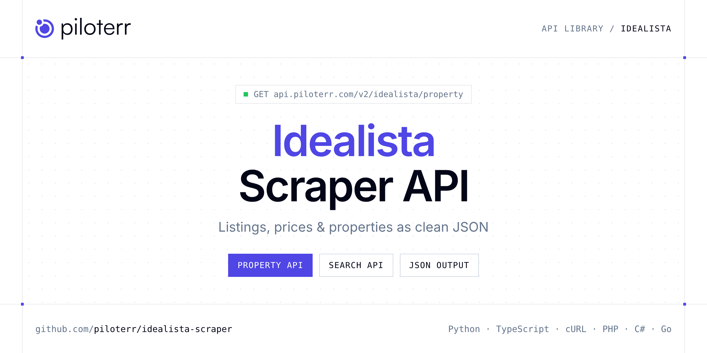

<p align="center">
  <a href="https://www.piloterr.com"></a>
</p>

# Idealista Scraper API

[](https://discord.gg/CFj3ph8aHU) [](https://app.piloterr.com) [](https://app.piloterr.com/openapi) [](LICENSE)

The **Piloterr Idealista Scraper API** lets you extract public data from Idealista as **clean, structured JSON** — no proxies, headless browsers or HTML parsing to maintain. Endpoints available in production:

- **Idealista Property API** — Extract full property details from an Idealista listing URL, including price, specs, photos by room, features, energy rating, and advertiser data.
- **Idealista Provinces API** — List the 50 Spanish provinces Idealista shows for homes for sale.
- **Idealista Search API** — Search Idealista listings from a search URL and retrieve prices, specs, photos, agency info, and pagination.

Use it for property price monitoring, market analytics, investment sourcing or rental yield models.

| Endpoint | Path | Credits | What you get |
|---|---|---|---|
| [Idealista Property API](#idealista-property-api) | `/v2/idealista/property` | 3 | Extract full property details from an Idealista listing URL, including price, specs, photos by room, features, energy rating, and advertiser data. |
| [Idealista Provinces API](#idealista-provinces-api) | `/v2/idealista/provinces` | 3 | List the 50 Spanish provinces Idealista shows for homes for sale. Each row includes the sale search URL to pass as query to Idealista Search. Madrid is madrid-provincia. |
| [Idealista Search API](#idealista-search-api) | `/v2/idealista/search` | 3 | Search Idealista listings from a search URL and retrieve prices, specs, photos, agency info, and pagination. Pass a province URL from `/v2/idealista/provinces` (`results[].url`) as `query`. Madrid is `https |

## Table of contents

- [How it works](#how-it-works)
- [Idealista Property API](#idealista-property-api)
- [Idealista Provinces API](#idealista-provinces-api)
- [Idealista Search API](#idealista-search-api)
- [Code examples in other languages](#code-examples-in-other-languages)
- [Practical use cases](#practical-use-cases)
- [Why Piloterr?](#why-piloterr)
- [FAQ](#faq)
- [Official SDKs](#official-sdks)
- [Related scrapers](#related-scrapers)
- [Support](#support)

## How it works

1. **Create a free Piloterr account** and copy your API key from the [dashboard](https://app.piloterr.com).
2. **Send a `GET` (or `POST`) request** to `https://api.piloterr.com/v2/...` with the header `x-api-key: YOUR_API_KEY`.
3. **Receive structured JSON** — Piloterr handles rendering, proxies, retries and parsing.

```bash
export PILOTERR_API_KEY="your-api-key"
pip install requests        # Python
# TypeScript: Node.js 18+ (native fetch), run with `npx tsx file.ts`
```

> Every endpoint accepts both `GET` (query string) and `POST` (JSON body with the same fields).

## Idealista Property API

Extract full property details from an Idealista listing URL, including price, specs, photos by room, features, energy rating, and advertiser data.

`GET | POST https://api.piloterr.com/v2/idealista/property` · **3 credits per request** · [Full reference](https://app.piloterr.com/openapi)

### Request parameters

| Parameter | Type | Required | Description |
|---|---|---|---|
| `query` | string | ✅ | Full Idealista property detail URL. |

### Python example

```python
import json
import os
import requests

response = requests.get(
    "https://api.piloterr.com/v2/idealista/property",
    headers={"x-api-key": os.environ["PILOTERR_API_KEY"]},
    params={
        "query": "https://www.idealista.com/fr/inmueble/111463799/",
    },
    timeout=120,
)
response.raise_for_status()
data = response.json()

print(json.dumps(data, indent=2, ensure_ascii=False)[:2000])
```

### TypeScript example

```typescript
type IdealistaProperty = {
  url?: string;
  plans?: string[];
  price?: number;
  title?: string;
  units?: unknown[];
  images?: {
    Photo?: string[];
    Salon?: string[];
    Chambre?: string[];
    Cuisine?: string[];
    "Salle de bains"?: string[];
  };
  address?: string[];
  updated?: string;
  currency?: unknown;
  features?: {
    Immeuble?: string[];
    "\u00c9quipement"?: string[];
    Caractéristiques?: string[];
    "Diagnostic de performance \u00e9nerg\u00e9tique"?: {
      emissions?: string;
      consumption?: string;
    };
  };
  location?: string;
  description?: string;
  advertiser_url?: string;
  advertiser_name?: string;
};

const params = new URLSearchParams({
  "query": "https://www.idealista.com/fr/inmueble/111463799/",
});

const response = await fetch(`https://api.piloterr.com/v2/idealista/property?${params}`, {
  headers: { "x-api-key": process.env.PILOTERR_API_KEY! },
});
if (!response.ok) throw new Error(`Piloterr error ${response.status}: ${await response.text()}`);

const data = (await response.json()) as IdealistaProperty;

console.log(JSON.stringify(data, null, 2).slice(0, 2000));
```

<details>
<summary><b>POST variant</b></summary>

```http
POST https://api.piloterr.com/v2/idealista/property
x-api-key: YOUR_API_KEY
Content-Type: application/json

{"query": "https://www.idealista.com/fr/inmueble/111463799/"}
```
</details>

### Output example

Example response from the API reference, abridged — real values depend on the page you scrape.

```json
{
  "url": "https://www.idealista.com/fr/inmueble/111463799/",
  "plans": [
    "https://img4.idealista.com/blur/WEB_DETAIL/0/id.pro.es.image.master/40/06/bd/1437393638.jpg"
  ],
  "price": 1650000,
  "title": "Appartement à vendre - Calle de Guzmán el Bueno",
  "units": [],
  "images": {
    "Photo": [
      "https://img4.idealista.com/blur/WEB_DETAIL/0/id.pro.es.image.master/ef/d3/38/1437388712.jpg",
      "https://img4.idealista.com/blur/WEB_DETAIL/0/id.pro.es.image.master/f9/a7/7c/1437388648.jpg"
    ],
    "Salon": [
      "https://img4.idealista.com/blur/WEB_DETAIL/0/id.pro.es.image.master/e7/b4/e6/1437388651.jpg",
      "https://img4.idealista.com/blur/WEB_DETAIL/0/id.pro.es.image.master/d8/27/78/1437388731.jpg"
    ],
    "Chambre": [
      "https://img4.idealista.com/blur/WEB_DETAIL/0/id.pro.es.image.master/4d/a4/f9/1437388711.jpg",
      "https://img4.idealista.com/blur/WEB_DETAIL/0/id.pro.es.image.master/32/0c/c6/1437388713.jpg"
    ],
    "Cuisine": [
      "https://img4.idealista.com/blur/WEB_DETAIL/0/id.pro.es.image.master/ff/c9/ed/1437388730.jpg"
    ],
    "Salle de bains": [
      "https://img4.idealista.com/blur/WEB_DETAIL/0/id.pro.es.image.master/10/6f/0b/1437388710.jpg"
    ]
  },
  "address": [
    "Calle de Guzmán el Bueno",
    "Quartier Gaztambide"
  ],
  "updated": "Annonce actualisée le 14 mai",
  "currency": null,
  "features": {
    "Immeuble": [
      "4ème étage logement sur rue",
      "Avec ascenseur"
    ],
    "Équipement": [
      "Climatisation"
    ],
    "Caractéristiques": [
      "Surface construite 190 m²",
      "4 chambres"
    ],
    "Diagnostic de performance énergétique": {
      "emissions": "D",
      "consumption": "C"
    }
  },
  "location": "Gaztambide, Madrid",
  "description": "Appartement de Luxe à Chamberí - Madrid | 190 m² | 4 Chambres\nDécouvrez votre nouveau chez-vous dans l'un des quartiers les plus exclusif…",
  "advertiser_url": "https://www.idealista.com/fr/pro/hillspropertiesbcn/",
  "advertiser_name": "Hills Properties"
}
```

### Response fields

| Field | Type | Description |
|---|---|---|
| `url` | string |  |
| `plans` | string[] |  |
| `price` | integer |  |
| `title` | string |  |
| `units` | any[] |  |
| `images` | object |  |
| `images.Photo` | string[] |  |
| `images.Salon` | string[] |  |
| `images.Chambre` | string[] |  |
| `images.Cuisine` | string[] |  |
| `images.Salle de bains` | string[] |  |
| `address` | string[] |  |
| `updated` | string |  |
| `currency` | object |  |
| `features` | object |  |
| `features.Immeuble` | string[] |  |
| `features.Équipement` | string[] |  |
| `features.Caractéristiques` | string[] |  |
| `features.Diagnostic de performance énergétique` | object |  |
| `location` | string |  |
| `description` | string |  |
| `advertiser_url` | string |  |
| `advertiser_name` | string |  |

## Idealista Provinces API

List the 50 Spanish provinces Idealista shows for homes for sale. Each row includes the sale search URL to pass as query to Idealista Search. Madrid is madrid-provincia.

`GET | POST https://api.piloterr.com/v2/idealista/provinces` · **3 credits per request** · [Full reference](https://app.piloterr.com/openapi)

### Request parameters

| Parameter | Type | Required | Description |
|---|---|---|---|

### Python example

```python
import json
import os
import requests

response = requests.get(
    "https://api.piloterr.com/v2/idealista/provinces",
    headers={"x-api-key": os.environ["PILOTERR_API_KEY"]},
    params={

    },
    timeout=120,
)
response.raise_for_status()
data = response.json()

print(json.dumps(data, indent=2, ensure_ascii=False)[:2000])
```

### TypeScript example

```typescript
type IdealistaProvinces = {
  results?: {
    url?: string;
    name?: string;
    slug?: string;
    region?: string;
    listing_count?: number;
  }[];
};

const params = new URLSearchParams({

});

const response = await fetch(`https://api.piloterr.com/v2/idealista/provinces?${params}`, {
  headers: { "x-api-key": process.env.PILOTERR_API_KEY! },
});
if (!response.ok) throw new Error(`Piloterr error ${response.status}: ${await response.text()}`);

const data = (await response.json()) as IdealistaProvinces;

console.log(JSON.stringify(data, null, 2).slice(0, 2000));
```

<details>
<summary><b>POST variant</b></summary>

```http
POST https://api.piloterr.com/v2/idealista/provinces
x-api-key: YOUR_API_KEY
Content-Type: application/json

{}
```
</details>

### Output example

Example response from the API reference, abridged — real values depend on the page you scrape.

```json
{
  "results": [
    {
      "url": "https://www.idealista.com/venta-viviendas/madrid-provincia/",
      "name": "Madrid",
      "slug": "madrid-provincia",
      "region": "Comunidad de Madrid",
      "listing_count": 34094
    }
  ]
}
```

### Response fields

| Field | Type | Description |
|---|---|---|
| `results[]` | object[] |  |
| `results[].url` | string |  |
| `results[].name` | string |  |
| `results[].slug` | string |  |
| `results[].region` | string |  |
| `results[].listing_count` | integer |  |

## Idealista Search API

Search Idealista listings from a search URL and retrieve prices, specs, photos, agency info, and pagination. Pass a province URL from `/v2/idealista/provinces` (`results[].url`) as `query`. Madrid is `https://www.idealista.com/venta-viviendas/madrid-provincia/`.

`GET | POST https://api.piloterr.com/v2/idealista/search` · **3 credits per request** · [Full reference](https://app.piloterr.com/openapi)

### Request parameters

| Parameter | Type | Required | Description |
|---|---|---|---|
| `query` | string | ✅ | Full Idealista search results URL. |

### Python example

```python
import json
import os
import requests

response = requests.get(
    "https://api.piloterr.com/v2/idealista/search",
    headers={"x-api-key": os.environ["PILOTERR_API_KEY"]},
    params={
        "query": "https://www.idealista.com/venta-viviendas/barcelona/ciutat-vella/la-barceloneta/",
    },
    timeout=120,
)
response.raise_for_status()
data = response.json()

print(json.dumps(data, indent=2, ensure_ascii=False)[:2000])
```

### TypeScript example

```typescript
type IdealistaSearch = {
  results?: {
    link?: string;
    price?: number;
    title?: string;
    details?: string[];
    picture?: string;
    currency?: string;
    description?: string;
    listing_company?: string;
    parking_included?: boolean;
    listing_company_url?: string;
  }[];
  pagination?: {
    next?: number;
    current?: number;
    other_pages?: number[];
    total_pages?: number;
    has_next_page?: boolean;
  };
};

const params = new URLSearchParams({
  "query": "https://www.idealista.com/venta-viviendas/barcelona/ciutat-vella/la-barceloneta/",
});

const response = await fetch(`https://api.piloterr.com/v2/idealista/search?${params}`, {
  headers: { "x-api-key": process.env.PILOTERR_API_KEY! },
});
if (!response.ok) throw new Error(`Piloterr error ${response.status}: ${await response.text()}`);

const data = (await response.json()) as IdealistaSearch;

console.log(JSON.stringify(data, null, 2).slice(0, 2000));
```

<details>
<summary><b>POST variant</b></summary>

```http
POST https://api.piloterr.com/v2/idealista/search
x-api-key: YOUR_API_KEY
Content-Type: application/json

{"query": "https://www.idealista.com/venta-viviendas/barcelona/ciutat-vella/la-barceloneta/"}
```
</details>

### Output example

Example response from the API reference, abridged — real values depend on the page you scrape.

```json
{
  "results": [
    {
      "link": "https://www.idealista.com/fr/inmueble/111463799/",
      "price": 1650000,
      "title": "Appartement - Calle de Guzmán el Bueno, Gaztambide, Madrid",
      "details": [
        "4 ch.",
        "190 m²"
      ],
      "picture": "https://img4.idealista.com/blur/480_360_mq/0/id.pro.es.image.master/e7/b4/e6/1437388651.jpg",
      "currency": "€",
      "description": "Appartement de Luxe à Chamberí - Madrid | 190 m² | 4 ChambresDécouvrez votre nouveau chez-vous dans l'un des quartiers les plus exclusifs…",
      "listing_company": "Hills Properties",
      "parking_included": false,
      "listing_company_url": "https://www.idealista.com/fr/pro/hillspropertiesbcn/"
    },
    {
      "link": "https://www.idealista.com/fr/inmueble/109948217/",
      "price": 968000,
      "title": "Appartement - Calle de Gaztambide, 39, Gaztambide, Madrid",
      "details": [
        "3 ch.",
        "126 m²"
      ],
      "picture": "https://img4.idealista.com/blur/480_360_mq/0/id.pro.es.image.master/a9/12/99/1391364999.jpg",
      "currency": "€",
      "description": "Découvrez votre nouveau chez-vous au cœur du quartier de Gaztambide! Ce spectaculaire appartement, entièrement rénové et neuf, dispose de…",
      "listing_company": "Gilmar Chamberi - Argüelles",
      "parking_included": false,
      "listing_company_url": "https://www.idealista.com/fr/pro/gilmarchamberi/"
    }
  ],
  "pagination": {
    "next": 2,
    "current": 1,
    "other_pages": [
      2,
      3
    ],
    "total_pages": 6,
    "has_next_page": true
  }
}
```

### Response fields

| Field | Type | Description |
|---|---|---|
| `results[]` | object[] |  |
| `results[].link` | string |  |
| `results[].price` | integer |  |
| `results[].title` | string |  |
| `results[].details` | string[] |  |
| `results[].picture` | string |  |
| `results[].currency` | string |  |
| `results[].description` | string |  |
| `results[].listing_company` | string |  |
| `results[].parking_included` | boolean |  |
| `results[].listing_company_url` | string |  |
| `pagination` | object |  |
| `pagination.next` | integer |  |
| `pagination.current` | integer |  |
| `pagination.other_pages` | integer[] |  |
| `pagination.total_pages` | integer |  |
| `pagination.has_next_page` | boolean |  |

## Code examples in other languages

Ready-to-run examples live in the [`examples/`](examples) folder. Each one reads your key from the `PILOTERR_API_KEY` environment variable.

| Language | Property | Provinces | Search |
|---|---|---|---|
| cURL (Bash) | [`property`](examples/curl/property.sh) | [`provinces`](examples/curl/provinces.sh) | [`search`](examples/curl/search.sh) |
| PHP | [`property`](examples/php/property.php) | [`provinces`](examples/php/provinces.php) | [`search`](examples/php/search.php) |
| C# | [`property`](examples/csharp/Property.cs) | [`provinces`](examples/csharp/Provinces.cs) | [`search`](examples/csharp/Search.cs) |
| Go | [`property`](examples/go/property.go) | [`provinces`](examples/go/provinces.go) | [`search`](examples/go/search.go) |
| Java | [`property`](examples/java/PropertyExample.java) | [`provinces`](examples/java/ProvincesExample.java) | [`search`](examples/java/SearchExample.java) |
| Ruby | [`property`](examples/ruby/property.rb) | [`provinces`](examples/ruby/provinces.rb) | [`search`](examples/ruby/search.rb) |
| Node.js | [`property`](examples/nodejs/property.mjs) | [`provinces`](examples/nodejs/provinces.mjs) | [`search`](examples/nodejs/search.mjs) |

## Practical use cases

- **Price monitoring** — Track asking prices and price drops per area.
- **Market analytics** — Measure inventory, days on market and price per m² / sqft.
- **Investment sourcing** — Detect undervalued properties as soon as they are listed.
- **Rental yield models** — Combine sale and rent listings to estimate yields.
- **Proptech products** — Power portals, valuation tools and alerts with structured listings.

## Why Piloterr?

- **No infrastructure** — no proxies, headless browsers or CAPTCHA solving to run yourself.
- **Structured JSON** — stable, documented fields instead of brittle HTML selectors.
- **Pay per request** — transparent credit cost per endpoint, failed requests are retried for you.
- **One API key, hundreds of sources** — Idealista plus many other e-commerce, search and company data endpoints in the [Piloterr library](https://www.piloterr.com/library).
- **Any language** — plain HTTPS + JSON, with examples for Python, TypeScript, cURL, PHP, C#, Go, Java, Ruby and Node.js.

## FAQ

### Is it legal to scrape Idealista?

Collecting publicly available data is generally allowed in many jurisdictions, but rules depend on your country, the data you collect and how you use it. Avoid personal data unless you have a lawful basis, respect the website's terms where they apply, and get legal advice for your specific use case. This is not legal advice.

### Do I need proxies or a headless browser?

No. Piloterr handles rendering, proxy rotation and retries on its side. You only send an HTTPS request with your `x-api-key` header and receive JSON.

### How much does a request cost?

Credits per call: `/v2/idealista/property` **3**, `/v2/idealista/provinces` **3**, `/v2/idealista/search` **3**. See the [Piloterr website](https://www.piloterr.com) for plans.

### What data does the Idealista API return?

Each endpoint returns structured JSON: **Idealista Property** — `url`, `plans`, `price`, `title`, `units`, `images`; **Idealista Provinces** — `results[]`, `results[].url`, `results[].name`, `results[].slug`, `results[].region`, `results[].listing_count`; **Idealista Search** — `results[]`, `results[].link`, `results[].price`, `results[].title`, `results[].details`, `results[].picture`.

### Which languages are supported?

Any language that can make an HTTP request. This README shows Python and TypeScript; the [`examples/`](examples) folder contains cURL, PHP, C#, Go, Java, Ruby and Node.js.

## Official SDKs

Use Piloterr from your own language with a typed client:

| SDK | Package | Install |
| --- | --- | --- |
| Node.js | [`@piloterr/sdk`](https://www.npmjs.com/package/@piloterr/sdk) | `npm install @piloterr/sdk` |
| Python | [`piloterr`](https://pypi.org/project/piloterr/) | `pip install piloterr` |
| Go | [`piloterr-go`](https://pkg.go.dev/github.com/piloterr/piloterr-go) | `go get github.com/piloterr/piloterr-go` |
| .NET | [`Piloterr`](https://www.nuget.org/packages/Piloterr) | `dotnet add package Piloterr` |
| Ruby | [`piloterr`](https://rubygems.org/gems/piloterr) | `gem install piloterr` |
| PHP | [`piloterr/sdk`](https://packagist.org/packages/piloterr/sdk) | `composer require piloterr/sdk` |
| Java | [`piloterr-java`](https://github.com/piloterr/piloterr-java) | build from source, see its README |
| CLI | [`@piloterr/cli`](https://www.npmjs.com/package/@piloterr/cli) | `npm install -g @piloterr/cli` |
| MCP server | [`@piloterr/mcp`](https://www.npmjs.com/package/@piloterr/mcp) | `npx -y @piloterr/mcp` |

## Related scrapers

- [Apartments Scraper API](https://github.com/piloterr/apartments-scraper)
- [Argenprop Scraper API](https://github.com/piloterr/argenprop-scraper)
- [Centris Scraper API](https://github.com/piloterr/centris-scraper)
- [Fotocasa Scraper API](https://github.com/piloterr/fotocasa-scraper)
- [Funda Scraper API](https://github.com/piloterr/funda-scraper)
- [Homestra Scraper API](https://github.com/piloterr/homestra-scraper)
- [All Piloterr scrapers on GitHub](https://github.com/piloterr)

## Support

- 💬 Join the [Piloterr Discord](https://discord.gg/CFj3ph8aHU) to ask questions and share what you build.
- 📚 Browse the [API reference (OpenAPI)](https://app.piloterr.com/openapi) and the [Piloterr library](https://www.piloterr.com/library).
- 🔑 [Get your API key](https://app.piloterr.com).

---

<p align="center">
  <a href="https://www.piloterr.com">
    <picture>
      <source media="(prefers-color-scheme: dark)" srcset="images/logo-dark.svg">
      
    </picture>
  </a>
  <br>
  <sub>Built by <a href="https://www.piloterr.com">Piloterr</a> — web scraping APIs for e-commerce, search, real estate and more, one API key.</sub>
</p>

<sub>Idealista is a trademark of its respective owner. This repository is not affiliated with or endorsed by Idealista. Examples are released under the MIT license.</sub>
